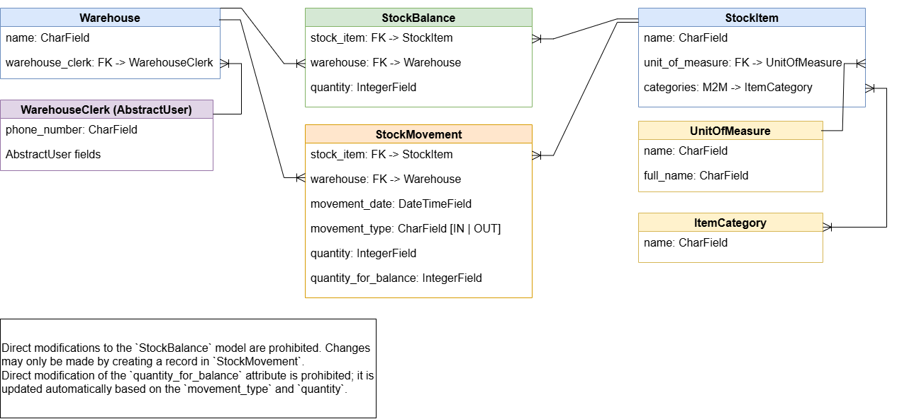

# Warehouse Management (Light)

A lightweight Django web application for keeping track of stock in a small warehouse:
what items you have, where they are stored, and how much of each item is left after every
incoming and outgoing movement.

> **Note:** This is a demonstration project created as part of a developer portfolio. 
> It is not intended for production use.

## Live Demo

**Demo:** [Warehouse Management Light](https://warehouse-management-light.onrender.com/)

**Demo user:** ```demo-user```   
**Password for demo user:** ```demo-password5```


## Features

- Custom user model (`WarehouseClerk`) with an optional phone number
- Reference data: units of measure and item categories
- Stock items with a unit of measure and multiple categories
- Warehouses, each assigned to a responsible clerk
- Stock movements (`IN` / `OUT`) that automatically maintain stock balances
- Tabler-based responsive UI with a sidebar navigation

## Tech Stack

- Backend: Python, Django
- Database: SQLite (for development environment), PostgreSQL (for production environment) 
- Frontend: Django templates, [Tabler](https://tabler.io/)


## Data Model

-   
- [Diagram (drawio format)](docs/models.drawio)


| Model           | Purpose                                                                 |
|-----------------|-------------------------------------------------------------------------|
| `WarehouseClerk`| Custom user (`AbstractUser` + `phone_number`). Used as `AUTH_USER_MODEL`.|
| `UnitOfMeasure` | Short name (e.g. `pcs`) and full name (e.g. `pieces`).                  |
| `ItemCategory`  | Category name (Clothing, Footwear, Electronics, ...).                   |
| `StockItem`     | Item name, one unit of measure, many categories.                        |
| `Warehouse`     | Warehouse name and its responsible clerk.                               |
| `StockBalance`  | Current quantity of an item in a warehouse.                             |
| `StockMovement` | A single `IN` or `OUT` movement of an item in a warehouse.              |

All foreign keys use `on_delete=RESTRICT`, so referenced records cannot be deleted
while they are still in use.

## Stock Movement Rules

These are the business rules the application enforces:

1. **Movements drive balances.** Saving a `StockMovement` automatically creates or
   updates the matching `StockBalance` (same item + warehouse).
2. **Balances are read-only.** `StockBalance` must never be written to directly
   (not through forms, views, or the admin) — only through movements.
3. **`quantity` is always positive.**
4. **`quantity_for_balance` is calculated automatically** and cannot be edited by hand.
   Its sign depends on `movement_type`:
   - `IN`  → `+quantity`
   - `OUT` → `-quantity`

   The balance is then changed by `quantity_for_balance`.

## Getting Started

### Prerequisites

- Python 3.12+ (or the version required by your Django release)
- `pip`

### Installation

- Clone the repository
```bash
git clone <repository-url>
cd <project-folder>
```

- Create and activate a virtual environment
```bash
python -m venv .venv
source .venv/bin/activate        # Windows: .venv\Scripts\activate
```
- Install dependencies   
    - development
    ```bash
    pip install -r requirements_dev.txt     
    ```
    - production
    ```bash
    pip install -r requirements_prod.txt  
    ```
- Environment variables      
Create a `.env` file from the example:
```bash
cp .env.example .env
```
Then, update the variables in the .env file.

| Variable | Required | Description |
|----------|----------|-------------|
| `SECRET_KEY` | always | Long random string (50+ characters) |
| `DJANGO_SETTINGS_MODULE` | always | `config.settings.dev` (default) or `config.settings.prod` |
| `DB_NAME`, `DB_USER`, `DB_PASSWORD`, `DB_HOST`, `DB_PORT` | production | PostgreSQL connection |
| `DB_SSLMODE`, `DB_CHANNEL_BINDING` | production | SSL options for the database connection |
| `RENDER_EXTERNAL_HOSTNAME` | production | Public hostname of the deployed app (used for `ALLOWED_HOSTS`) |

- Apply migrations
```bash
python manage.py migrate
```
- Create an administrator
```bash
python manage.py createsuperuser
```
- Run the development server
```bash
python manage.py runserver
```
Open http://127.0.0.1:8000/ for the site and http://127.0.0.1:8000/admin/ for the admin panel.

## Load Demo Data

To populate the database with demo data, run:

```bash
python manage.py loaddata demo_data.json
```